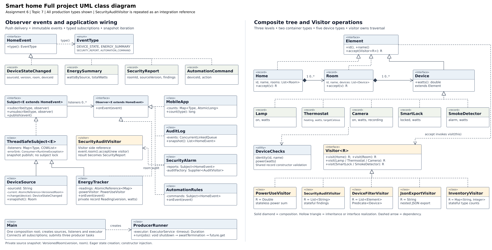

# Smart home

Assignment 6 — Observer and Visitor Patterns, **topic 7**. Author: **Amir Kabdilmalik**, group **SE-2532**, student ID **250671**.

This Java 17 console simulation has three independent room sources, five listeners, an observer chain, a Composite tree, and five Visitors. A device update triggers a security audit of its room and publishes the audit as a new event. It uses the Java standard library in production and JUnit 5 in tests. It does not require real devices, a server, a database, or an event-bus library.

## Open and run

Unzip the archive. In a terminal, enter the `smart-home` folder. The runnable JAR is included, so Java 17 is enough for the demo:

```bash
java -jar dist/smart-home.jar
java -jar dist/smart-home.jar 4 1000
```

The arguments are the executor thread count (minimum 3) and updates per producer (minimum 1). Defaults: `3 100`. There are always three producer tasks. `run.cmd` works on Windows; `bash run.sh` works on Linux/macOS. In IntelliJ IDEA, open `pom.xml` as a Maven project, select JDK 17, and run `smarthome.Main`.

To compile and run the official JUnit suite, install JDK 17 and Maven 3.9 or newer:

```bash
mvn clean test
mvn package
java -jar target/smart-home-1.0.0.jar 3 100
```

Maven needs internet access on its first run to obtain JUnit and build plugins. Business code has no external dependencies. For a dependency-free check using JDK 17:

```bash
java --class-path dist/smart-home.jar validation/VerifyMain.java
```

That command performs 11 checks, including the exact 4,000-event stress check. It is separate from the JUnit suite.

## Expected default output

```text
SMART HOME | Assignment 6 | Topic 7
Producer threads: 3, producers: 3
DEVICE_STATE received: 300
ENERGY_SUMMARY received: 300
SECURITY_REPORT received: 300
AUTOMATION_COMMAND received: 50
Audit log entries: 950
Final power: 1017.0 W
Security findings: [lock: door is unlocked]
Devices rated above 100 W: 1
Inventory: {Camera=1, Lamp=2, SmartLock=1, SmokeDetector=1, Thermostat=1}
...
Listener failures: 0
```

`docs/demo-output.txt` contains the complete output, including JSON. The three producers change the thermostat target, front-door lock, and bedroom lamp. Targets alternate between 22 and 28 C; only the 50 hot updates create automation recommendations. All 300 device updates create both an energy summary and a security report. Therefore the audit log contains `300 + 300 + 300 + 50 = 950` entries.

The final power is `0 + 1000 + 8 + 2 + 6 + 1 = 1017 W`. Power is an instantaneous rate. It is not energy in kWh; energy would require elapsed time. The thermostat's watts represent the controlled heater's demand. Locks and smoke detectors consume standby power even when their status changes.

## Requirements and implementation

| Assignment requirement | Implementation |
| --- | --- |
| Java 17 and JUnit 5 only | `pom.xml`; standard Java APIs in production; JUnit 5.11.4 in test scope |
| At least two subjects | Three `DeviceSource` objects; `EnergyTracker` is another subject |
| At least five listeners | `MobileApp`, `EnergyTracker`, `SecurityAlarm`, `AutomationRules`, `AuditLog` |
| Own generic interfaces | `Subject<E extends HomeEvent>` and `Observer<E extends HomeEvent>` |
| Immutable typed events | Four records implementing `HomeEvent`; `EventType` selects subscriptions |
| Join and leave during callbacks | Copy-on-write subscriber snapshots; covered by tests |
| Listener also acts as a subject | `DeviceSource → EnergyTracker → MobileApp/AuditLog` |
| Stable Composite with three levels | `Home → Room → Device`; containers are Home and Room |
| At least four leaf types | Lamp, Thermostat, Camera, SmartLock; SmokeDetector added separately |
| Generic Visitor and double dispatch | `Visitor<R>`; each concrete record implements `accept(v) { return v.visit(this); }` |
| Four required visitor categories | PowerUseVisitor, SecurityAuditVisitor, DeviceFilterVisitor, JsonExportVisitor |
| Additional operation | InventoryVisitor counts each device type across the whole tree |
| Event triggers related subtree Visitor | SecurityAlarm audits only `changed.room()` and publishes SecurityReport |
| At least three executor producers | Three tasks on an injected fixed ExecutorService, default thread count 3 |
| Thread-safe shared state | CopyOnWriteArrayList, immutable records, AtomicReference CAS, AtomicLong, ConcurrentLinkedQueue |
| Graceful shutdown | shutdown, awaitTermination, Future.get; explicit failure on timeout |
| One composition root and constructor injection | Main creates and connects services; dependencies are constructor parameters |
| At least 15 JUnit tests | 39 test methods in six test classes |
| Exact stress test | Four synchronized producers × 1,000 events = exactly 4,000 deliveries |
| Hand-calculated Visitor expectations | Test fixture: living 1020 W, bedroom 1 W, whole home 1021 W; three audit findings |
| New-operation and new-element commits | Tags `new-visitor` and `new-element`; exact changed files below |
| UML and report | `docs/Smart_home_UML.png`, editable SVGs, report, and explanation |
| Meaningful history over two weeks | Included commits are real work from this preparation session; a two-week history remains the student's responsibility |
| GitHub link and live defense | Create your own repository, run JUnit there, submit its link and report, and complete the live defense |

## Observer design

A subject is an object that sends notifications. An observer is an object that receives them. A source receives a new immutable device value through `change(device)`, replaces the matching device in its room, and publishes a `DeviceStateChanged` record.

The notification carries the room snapshot, source ID, source-local version, and changed device ID. This is **push**: observers already have the data they need. Pulling from the source afterward could read a newer room than the one that caused the notification. Passing immutable data also lets callbacks run safely on different producer threads.

Each event type has its own eagerly created `CopyOnWriteArrayList`. `subscribe` uses `addIfAbsent`, so registering the same observer twice does not duplicate delivery. An iterator captures the array at the start of a publication. A callback may subscribe or unsubscribe without invalidating that iterator. A newly joined listener receives future snapshots. A removed listener may still receive an event from a snapshot already captured by another publisher. Unsubscribe is not a barrier that waits for existing callbacks.

The registry does not lock the whole subject. Copy-on-write updates lock only their own list internally. This favors a small, stable subscriber set with many more notifications than subscription changes. It costs an array copy when subscriptions change.

Callbacks run synchronously on the publishing thread. A slow callback slows that producer; there is no hidden queue. Each callback's RuntimeException is sent to the injected, nonthrowing error sink, and delivery continues to the next listener. Main uses a concurrent error queue and fails visibly after processing if any listener failed. There is no durable delivery or automatic retry.

The five device-event listeners are:

| Listener | Responsibility |
| --- | --- |
| MobileApp | Thread-safe counts of received event types; the demo's mobile display model |
| EnergyTracker | Calculates room power, retains newest source readings, publishes aggregate EnergySummary events |
| SecurityAlarm | Runs a fresh security visitor on the event room and publishes a report |
| AutomationRules | Recommends 22 C when the updated thermostat is heating above 26 C |
| AuditLog | Stores received immutable events in a concurrent queue |

Automation commands are recommendations displayed and logged by the system. They do not control physical hardware or trigger recursive state-change loops.

## Visitor and Composite design

Home contains rooms, and a room contains devices. These are three levels. Home and Room are two distinct container types. Leaves have no children. Device records store data and perform constructor validation and dispatch; power, security, filtering, counting, and serialization rules live in visitors.

`Visitor<R>` means each operation chooses its own result type. Power returns Double; the audit returns List<String>; filtering returns List<Element>; JSON returns String; inventory returns Map<String, Integer>.

Double dispatch happens in two steps:

```java
Element element = new Lamp("l", "Lamp", true, 10);
Double watts = element.accept(new PowerUseVisitor());
```

First Java calls the actual element's `Lamp.accept`. Inside that method, `this` has the compile-time type Lamp, so `visitor.visit(this)` selects `visit(Lamp)`. Java then calls the actual visitor implementation's method. A client with only an Element reference cannot simply call `visit(element)` because Visitor has overloads for the concrete types and no `visit(Element)` method. Adding a generic fallback would lose the explicit handling that demonstrates Visitor.

**Visitors own traversal.** `visit(Home)` visits its rooms; `visit(Room)` visits its devices. This keeps element records free of operations and lets JSON create exactly one nested child array per container. Each operation controls its own recursion. The related container loops in different visitors express different operations and return types rather than a shared mutable traversal engine.

PowerUseVisitor is stateless and reusable. SecurityAuditVisitor and InventoryVisitor accumulate state during a traversal; use a fresh instance for every independent run. SecurityAlarm receives an injected factory for this reason. Creating a fresh operation per audit is not lazy initialization of a service: all service fields are initialized during construction.

JsonExportVisitor writes JSON by hand. It includes Home.rooms and Room.devices arrays and all device fields, escapes quotes, backslashes, control characters and UTF-16 surrogates, and rejects non-finite numeric device data through constructor validation. It uses no JSON library.

## Integration example

1. The entrance source publishes a room snapshot containing an unlocked lock.
2. SecurityAlarm receives that DeviceStateChanged event.
3. It calls `changed.room().accept(auditFactory.get())`.
4. The visitor inspects the entrance's devices only.
5. SecurityAlarm publishes a SecurityReport such as `lock: door is unlocked`.
6. MobileApp and AuditLog receive that report.

The integration test uses another room with a known insecure camera and proves that camera is absent from the entrance/living-room report. There is no traversal of unrelated rooms to locate the subtree because the event already contains it.

## Concurrency and shutdown

Each source owns one room and has a unique source ID. An AtomicReference stores an immutable `(version, room)` snapshot. A CAS update replaces that snapshot atomically. Any retried update function only builds data; it does not publish. Publication occurs once, after the successful update.

EnergyTracker uses a CAS-updated immutable map of source IDs to versioned power readings. Older versions cannot overwrite newer readings. Each summary is derived from one complete immutable map. Sources must not share an ID, and the demo uses one source for each room. Aggregated totals cover the sources that have reported so far.

Concurrent publications have no global callback order. A completed older summary can arrive after a newer summary. MobileApp deliberately counts events rather than treating the last delivered summary as a globally ordered current value. Final power is computed from source snapshots after all producer tasks terminate.

AtomicLong protects counters, ConcurrentLinkedQueue protects audit/error records, and final immutable lists/maps protect event payloads. Stateful visitors are confined to one audit or traversal. No application-wide synchronized block is used.

ProducerRunner receives its executor and timeout in its constructor. After submitting finite producer tasks, it calls shutdown and waits for completion before inspecting futures. Synchronous event delivery means the last completed task has also completed its observer chains. Producer exceptions are surfaced through Future.get. The normal demo drains all events and leaves no worker threads. If the 30-second limit expires, it cancels remaining tasks and throws an explicit failure; lossless processing is not claimed after cancellation. Arbitrary callbacks that ignore interruption cannot be forcibly made safe by Java's executor API.

## Clean Code choices

Main is the composition root: all service construction, factories, subscriptions, and the executor are visible there. Collaborating services receive their dependencies through constructors. There are no service locators, dependency setters, lazy singleton services, event-bus dependencies, or java.util.Observable. Shared validation is in the small DeviceChecks utility to avoid repeating validation rules in every record. Data records, generic interfaces, visitor operations, listeners, and executor lifetime each have a concrete role.

## Tests and verified results

| Test class | Test methods | Main coverage |
| --- | ---: | --- |
| ObserverTest | 9 | Typed delivery, duplicates, add/remove inside handlers, failure isolation, immutable payloads, multiple sources |
| VisitorTest | 12 | Hand calculations, stateful audit, filter, exact nested JSON, escaping, dispatch, validation |
| IntegrationTest | 7 | Related room only, report publication, aggregate chain, version handling, automation, immutable source snapshots |
| ConcurrencyTest | 5 | Exact 4000 deliveries, in-flight unsubscribe, concurrent aggregation, shutdown, producer failures |
| InventoryVisitorTest | 2 | New operation over unchanged elements, empty tree |
| SmokeDetectorTest | 4 | New leaf supported by all five visitors |
| Total | 39 | More than the required 15 |

During preparation, production code compiled with Java 17 and `-Xlint:all`; the runnable JAR, default demo, parameterized demos, JSON parsing, and 11 standalone checks were executed. All 39 test bodies also passed a temporary local assertion compatibility harness. That harness is **not the official JUnit engine** and is not included as a substitute dependency. Maven and the official JUnit artifact could not be downloaded in the preparation environment. Therefore `mvn clean test` remains a required check on your machine. Do not report the official JUnit suite as passed until that command succeeds. `docs/test-body-results.txt` labels the local evidence explicitly.

## Trade off proof with real commits

Run these commands inside a clone restored from the supplied Git bundle:

```bash
git log --oneline --decorate --all
git show --stat new-visitor
git show --name-only new-visitor
git show --stat new-element
git show --name-only new-element
```

The **new-visitor** commit changes exactly three files:

- `src/main/java/smarthome/InventoryVisitor.java` — new operation.
- `src/test/java/smarthome/InventoryVisitorTest.java` — its tests.
- `README.md` — records the trade-off.

No existing element, Visitor interface, or composition-root file changes. Its cost is one new operation and tests. It can be called directly on any existing Element.

The **new-element** commit changes exactly ten files:

- `src/main/java/smarthome/SmokeDetector.java` — new leaf.
- `src/main/java/smarthome/Visitor.java` — new visit overload.
- `src/main/java/smarthome/PowerUseVisitor.java` — standby demand.
- `src/main/java/smarthome/SecurityAuditVisitor.java` — smoke alert.
- `src/main/java/smarthome/DeviceFilterVisitor.java` — filtering support.
- `src/main/java/smarthome/JsonExportVisitor.java` — export fields.
- `src/main/java/smarthome/InventoryVisitor.java` — count the new type.
- `src/main/java/smarthome/Main.java` — instantiate the new device and show inventory.
- `src/test/java/smarthome/SmokeDetectorTest.java` — new-leaf tests.
- `README.md` — records the cost.

Visitor is a good fit when the object types are fairly stable and operations change often. If new device classes were being added every week and there were many visitors, updating every visitor would be costly. In that situation, reconsider Visitor or choose a data-driven device model. Explicit overloads make unsupported new types a compile-time problem.

## UML and project guide



Open the PNG or SVG and zoom for the complete diagram. `uml-observer.png` and `uml-visitor.png` are enlarged panels also used in the report. The full picture shows all production types; SecurityAuditVisitor is repeated once as an integration reference. Dashed hollow triangles are interface realization, solid hollow triangles are interface/class inheritance, filled diamonds are composition, and dashed ordinary arrows are dependencies. Some constructor dependencies are expressed in typed fields to keep the picture readable.

`docs/EXPLANATION.md` explains every class and the difficult Java concepts in simple language. `docs/DEFENSE_GUIDE.md` includes likely questions and live-coding exercises. `docs/Smart_home_Report.docx` is the editable report.

## Preserve history and submit

The archive contains the source folder and a sibling `Smart_home_history.bundle`. Copying only source files into an empty repository loses the two proof commits. To preserve them, open a terminal in the extracted archive's top-level folder and run:

```bash
git clone Smart_home_history.bundle smart-home-with-history
cd smart-home-with-history
mvn clean test
```

Create an empty GitHub repository in your own account, then attach its actual URL as the remote and push `main` and the tags. Do this yourself after reviewing the code. No remote repository has been created or pushed by this project preparation.

All included commits have their real preparation dates. They do not demonstrate development over two weeks. Continue making genuine changes and test/defense practice commits during the assigned period; do not backdate history. Submit your own GitHub link and the report to LMS, and prepare to explain and edit the code live. Code is 50 points; the live defense is another 50 points in the assignment.
